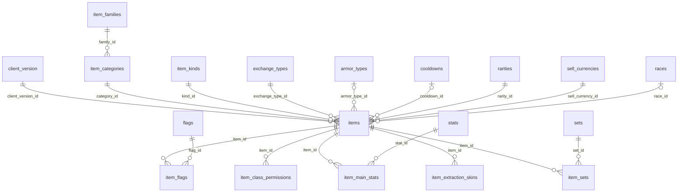

# Items : base SQLite relationnelle

`items` est la table principale : chaque ligne décrit un objet, avec son nom
anglais, son nom localisé, ses descriptions et ses propriétés utiles. Elle
contient des clés étrangères vers les référentiels et la dernière version
client où une modification de ses données conservées a été constatée.
Les tables métier sont complétées par les sources décodées compressées et la
couverture dans l’[export commun](game-data-export.md).

## Tables et relations

| Table | Rôle |
| --- | --- |
| `items` | Objets, textes EN/localisés et propriétés : niveau, rareté, icône, prix de revente, monnaie, extensibilité, taux d'extraction, pile, etc. |
| `client_version` | Builds Steam observés ; `items.client_version_id` indique le dernier build où l'item a changé. |
| `item_families` | Familles Equip, Usable, Misc et Currency. |
| `item_categories` | Catégories précises, chacune liée à sa famille : Greatsword, Potion, etc. `items.category_id` pointe vers cette table. |
| `item_kinds` | Types généraux (weapon, armor, potion, etc.), référencés par `items.kind_id`. |
| `exchange_types` | Types d’échange, référencés par `items.exchange_type_id`. |
| `localization_language` | Une seule ligne indiquant la langue sélectionnée pour toute la base. |
| `armor_types` | Types d'armure ; `items.armor_type_id` est NULL quand aucun type n'est applicable. |
| `cooldowns` | Chaque valeur numérique de cooldown est stockée une seule fois ; les items utilisent `cooldown_id`. L'unité reste non confirmée. |
| `rarities` | Couple rareté affichée / valeur source, référencé par `items.rarity_id`. |
| `sell_currencies` | Code de monnaie et enum source `sell_currency_type` (SellCurrencyType), référencés par `items.sell_currency_id`. |
| `races` | All, Light / Elyos et Dark / Asmodian, référencés par `items.race_id` ; la valeur source None donne NULL. |
| `flags` | Dictionnaire des noms de permissions, par exemple CanSell. |
| `item_flags` | Uniquement les couples item / flag actif ; une absence seule ne prouve pas faux ; voir `item_false_flags`. |
| `item_class_permissions` | Couples item / indice de classe autorisée, issus de CanUseClassList ; une absence signifie faux, sans colonne `can_use`. Aucun nom de classe n’est supposé. |
| `stats` | Dictionnaire des codes de statistiques ; `name_en` et `name_localized` restent NULL jusqu'à leur saisie. |
| `item_main_stats` | Références `stat_id` vers `stats`, avec la valeur entière et l'ordre de chaque statistique de l'item. |
| `item_extraction_skins` | Couples item / clé de skin possible, sans position ni doublon. |
| `sets` | Clés de sets stockées une seule fois, avec un petit identifiant. |
| `item_sets` | Couples `item_id` / `set_id`, sans position ni doublon. |

`item_flags` conserve les permissions vraies ; `item_false_flags` conserve les
valeurs explicitement fausses. Une absence des deux signifie inconnue. Les
listes de classes originales sont conservées dans les sources, sans déduire
les noms de classes depuis les indices. `extensible` est un booléen lorsqu’il
est applicable ; les autres cas conservent leur source et leur couverture.

Les identifiants de référentiels et leurs clés étrangères sont déclarés
SMALLINT, avec une borne de 1 à 32 767. SQLite choisit la taille physique de
chaque entier selon sa valeur ; SMALLINT ne réserve pas deux octets fixes.
Les colonnes `magic_stone_slots` et `godstone_slots` sont déclarées TINYINT,
avec une borne de 0 à 255 et NULL si elles ne sont pas applicables ; la taille
physique reste choisie par SQLite.
Les petits référentiels et les tables de liaison utilisent WITHOUT ROWID pour
éviter un identifiant de ligne implicite supplémentaire. Les identifiants du
jeu dans `items.id` gardent leur taille nécessaire et ne sont pas limités à
16 bits. Les dépassements de capacité des référentiels font échouer l'import
en conservant la base précédente.

## Export, compléments et versions

L’[export commun](game-data-export.md) reconstruit les objets et compétences
dans `%LOCALAPPDATA%\Aetheris\data.sqlite`, avec anglais et langue choisie.
Il remplace les commandes indépendantes `export-items` et `export-skills`.
Les migrations des anciens schémas de développement ont été supprimées.

`item_details` conserve `PermitLevelMin`, `PermitLevelMax` et une référence
vers `item_tiers`. Les définitions d’ensembles, membres et bonus sont extraits
depuis `ItemSet` et `ItemSetEffect` ; plusieurs définitions peuvent partager
le même nom de set sans être fusionnées. Les liens de progression pointent
vers les lignes source d’enchantement, dépassement, succession et ajout d’âme.
Les coffres, packages et routes d’obtention sont conservés avec quantités,
choix, poids bruts, conditions source et références non résolues.

Les icônes et libellés disponibles utilisent les référentiels partagés.
Les descriptions gardent leurs balises et marqueurs ; les traductions absentes
restent NULL avec un état de repli explicite dans `catalogue_texts`.
`rarity_source` conserve l’enum `ItemGrade` ; Legend → Unique reste la
correspondance confirmée par l’opérateur. Les valeurs de `ExtractionSkinRate`
et les poids d’obtention ne sont pas convertis en pourcentages sans échelle
validée. Les champs inconnus restent dans `catalogue_sources`.

Le suivi commun distingue l’état initial des ajouts, modifications et
suppressions observées, avec les builds de comparaison ; une réapparition
est un ajout. Il conserve les dernières données fiables et n’attribue pas
les changements de langue ou de couverture à une mise à jour du jeu.
Voir `catalogue_entries` et les limites détaillées dans l’export commun.
