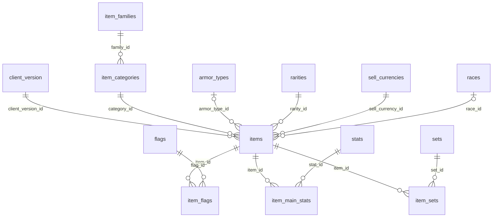

# Items : base SQLite relationnelle

`items` est la table principale : chaque ligne décrit un objet, avec son nom
anglais, son nom localisé, ses descriptions et ses propriétés utiles. Elle
contient des clés étrangères vers les référentiels et la dernière version
client où une modification de ses données conservées a été constatée.
Les tables métier sont complétées par les sources décodées compressées et la
couverture dans l’[export commun](game-data-export.md).

## Tables et relations

| Table | Rôle |
| --- | --- |
| `items` | Objets, textes EN/localisés et propriétés : niveau, rareté, prix de revente, monnaie et emplacements de pierres. |
| `client_version` | Builds Steam observés ; `items.client_version_id` indique le dernier build où l'item a changé. |
| `item_families` | Familles Equip, Usable, Misc et Currency. |
| `item_categories` | Catégories précises, chacune liée à sa famille : Greatsword, Potion, etc. `items.category_id` pointe vers cette table. |
| `localization_language` | Une seule ligne indiquant la langue sélectionnée pour toute la base. |
| `armor_types` | Types d'armure ; `items.armor_type_id` est NULL quand aucun type n'est applicable. |
| `rarities` | Couple rareté affichée / valeur source, référencé par `items.rarity_id`. |
| `sell_currencies` | Code de monnaie et enum source `sell_currency_type` (SellCurrencyType), référencés par `items.sell_currency_id`. |
| `races` | All, Light / Elyos et Dark / Asmodian, référencés par `items.race_id` ; la valeur source None donne NULL. |
| `flags` | Dictionnaire des noms de permissions, par exemple CanSell. |
| `item_flags` | Uniquement les couples item / flag actif ; une absence seule ne prouve pas faux ; voir `item_false_flags`. |
| `stats` | Dictionnaire des codes de statistiques ; `name_en` et `name_localized` restent NULL jusqu'à leur saisie. |
| `item_main_stats` | Références `stat_id` vers `stats`, avec la valeur entière et l'ordre de chaque statistique de l'item. |
| `sets` | Clés de sets stockées une seule fois, avec un petit identifiant. |
| `item_sets` | Couples `item_id` / `set_id`, sans position ni doublon. |

`item_flags` conserve les permissions vraies ; `item_false_flags` conserve les
valeurs explicitement fausses. Une absence des deux signifie inconnue. Les
listes de classes originales sont conservées dans les sources, sans déduire
les noms de classes depuis les indices. Les données non projetées restent dans les sources.

Les identifiants de référentiels et leurs clés étrangères sont déclarés
SMALLINT, avec une borne de 1 à 32 767. SQLite choisit la taille physique de
chaque entier selon sa valeur ; SMALLINT ne réserve pas deux octets fixes.
Les colonnes `magic_stone_slots` et `godstone_slots` sont déclarées TINYINT,
avec une borne de 0 à 255 et NULL si elles ne sont pas applicables ; la taille
physique reste choisie par SQLite.
Les petits référentiels et les tables de liaison utilisent WITHOUT ROWID pour
éviter un identifiant de ligne implicite supplémentaire. Les identifiants du
jeu dans `items.id` gardent leur taille nécessaire et ne sont pas limités à
16 bits. Les dépassements de capacité des référentiels font échouer l'import
en conservant la base précédente.

## Export, compléments et versions

L’[export commun](game-data-export.md) reconstruit les objets et compétences
dans `%LOCALAPPDATA%\Aetheris\data.sqlite`, avec anglais et langue choisie.
Il remplace les commandes indépendantes `export-items` et `export-skills`.
Les migrations des anciens schémas de développement ont été supprimées.

`item_details` conserve le niveau requis minimal `PermitLevelMin`. Les définitions d’ensembles, membres et bonus sont extraits
depuis `ItemSet` et `ItemSetEffect` ; plusieurs définitions peuvent partager
le même nom de set sans être fusionnées. Les liens de progression pointent
vers les lignes source d’enchantement, dépassement, succession et ajout d’âme.
Les coffres, packages et routes d’obtention sont conservés avec quantités,
choix, poids bruts, conditions source et références non résolues.

Les icônes et libellés disponibles utilisent les référentiels partagés.
Les descriptions gardent leurs balises et marqueurs ; les traductions absentes
restent NULL avec un état de repli explicite dans `catalogue_texts`.
`rarity_source` conserve l’enum `ItemGrade` ; Legend → Unique reste la
correspondance confirmée par l’opérateur. Les valeurs de `ExtractionSkinRate`
et les poids d’obtention ne sont pas convertis en pourcentages sans échelle
validée. Les champs inconnus restent dans `catalogue_sources`.

Le suivi commun distingue l’état initial des ajouts, modifications et
suppressions observées, avec les builds de comparaison ; une réapparition
est un ajout. Il conserve les dernières données fiables et n’attribue pas
les changements de langue ou de couverture à une mise à jour du jeu.
Voir `catalogue_entries` et les limites détaillées dans l’export commun.

## Projection de la fiche Penpot

Le format 7 supprime de la projection les types généraux inférés, types d’échange,
cooldowns d’items, pile maximale, effet d’utilisation, extensibilité, taux et
résultats d’extraction de skins, indices de classes, tier et niveau requis maximal.
Ces champs restent dans les lignes sources compressées ; leur retrait de la
projection ne supprime pas leur participation au suivi des changements du jeu.
La référence d’icône n’est plus dupliquée dans `items` : elle passe par
`catalogue_entity_icons` et `catalogue_icons`. La base doit être reconstruite.

La fiche interactive cherche les noms ou IDs réels. Les statistiques présentent
les valeurs de base, avec une seule plage pour l’attaque minimale/maximale.
Les bonus d’un équipement joueur, unités non établies et probabilités ne sont
pas déduits des exemples de la maquette. Les recettes et récompenses de quêtes
ne sont pas simulées à partir de son contenu d’illustration.

Le curseur de niveau sélectionne les paliers d’enchantement définis dans les
sources liées (`EnchantEffect`, ou `ArcanaEnchantEffectMainStat` pour les arcanas).
La fiche garde les statistiques de base et affiche leurs bonus à côté ; le nom
reçoit `+N` et le niveau d’objet affiche le supplément `ItemLevelValue`.
Les paliers manquants ne sont pas interpolés. Le curseur continue après le dernier
palier normal avec les niveaux `CurrentLevel` de `ExceedEnchant`.
Le titre et le curseur affichent alors +16, +17, etc. Les bonus de percée proviennent du lien explicite
`AdditionalStatName` vers `AdditionalStat` et occupent des lignes dédiées dans les
statistiques principales. Les valeurs brutes restent dans les sources. Ils ne sont pas additionnés entre paliers ; les bonus et le
supplément de niveau de l’enchantement maximal restent affichés. Le bonus de GS
ajoute **5 par percée**, selon la règle confirmée en jeu par l’utilisateur
(ce coefficient n’est pas déduit de `AdditionalStat`). Ludra +16 affiche donc
`102 (+20)` et +20 affiche `102 (+40)` : les 15 GS de l’enchantement normal,
plus respectivement 5 ou 25 GS de percée.
Dans l’en-tête Unique, le nom utilise `grade.unique-light`, la rareté
`grade.unique` et la catégorie ainsi que le niveau d’objet utilisent `white`.

La percée reprend le composant Penpot sous l’icône : losanges de 10 px tournés
à 45°, contour blanc à vide et contour vert avec centre de 6 px pour les paliers
atteints. Les bonus restent dans les statistiques principales, en `yellow-light`,
sans section de percée séparée. Le nombre de losanges suit les paliers de la source.

`EStat::AmplifyAllDamage` (Damage Boost) est exprimé en centièmes de pourcentage :
la fiche affiche `500` sous la forme `5 %`, sans réécrire les valeurs sources.

La fiche lit les portées dans la source `Item` déjà archivée : `WeaponAttackRange`
et `WeaponAttackHeightRange`, converties des centimètres en mètres. Le bonus
`ExtendingWeaponAttackRange` / `ExtendingWeaponAttackHeightRange` est affiché
séparément seulement si `ExtendingWeapon` est vrai. Les portées nulles sont masquées.
La ligne de pierre philosophale apparaît pour les équipements dont `SoulAddGroup`
résout une ligne `ItemSoulAdd`. « not fused » représente l’aperçu vierge de la
fiche catalogue ; l’état de liaison d’un équipement joueur n’est pas déduit.
Ces données proviennent des sources conservées et ne nécessitent pas de reconstruire la base.

La fiche masque le niveau d’objet zéro et les icônes de permissions fausses ou
absentes. Un niveau requis égal à 1 affiche « Usable at all levels ». Le prix de
vente positif est visible indépendamment de `CanSell` ; il décrit le catalogue,
sans affirmer qu’une instance joueur est vendable. Les valeurs sources ne changent pas.
