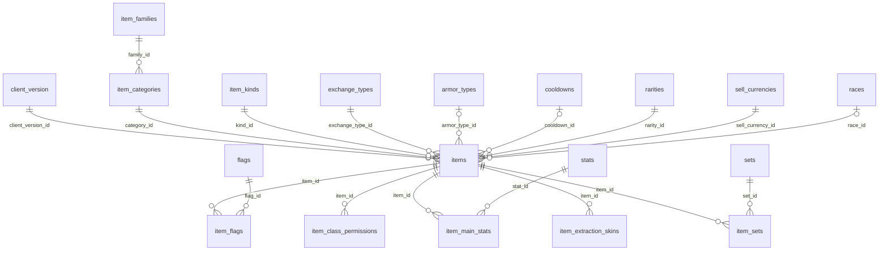

# Items : base SQLite relationnelle

`items` est la table principale : chaque ligne décrit un objet, avec son nom
anglais, son nom localisé, ses descriptions et ses propriétés utiles. Elle
contient des clés étrangères vers les référentiels et la dernière version
client où une modification de ses données conservées a été constatée.
La base ne contient ni copie des lignes brutes, ni colonnes JSON, ni vue
qui duplique les données de toutes les tables.

## Tables et relations

| Table | Rôle |
| --- | --- |
| `items` | Objets, textes EN/localisés et propriétés : niveau, rareté, icône, prix de revente, monnaie, extensibilité, taux d'extraction, pile, etc. |
| `client_version` | Builds Steam observés ; `items.client_version_id` indique le dernier build où l'item a changé. |
| `item_families` | Familles Equip, Usable, Misc et Currency. |
| `item_categories` | Catégories précises, chacune liée à sa famille : Greatsword, Potion, etc. `items.category_id` pointe vers cette table. |
| `item_kinds` | Types généraux (weapon, armor, potion, etc.), référencés par `items.kind_id`. |
| `exchange_types` | Types d’échange, référencés par `items.exchange_type_id`. |
| `localization_language` | Une seule ligne indiquant la langue sélectionnée pour toute la base. |
| `armor_types` | Types d'armure ; `items.armor_type_id` est NULL quand aucun type n'est applicable. |
| `cooldowns` | Chaque valeur numérique de cooldown est stockée une seule fois ; les items utilisent `cooldown_id`. L'unité reste non confirmée. |
| `rarities` | Couple rareté affichée / valeur source, référencé par `items.rarity_id`. |
| `sell_currencies` | Code de monnaie et enum source `sell_currency_type` (SellCurrencyType), référencés par `items.sell_currency_id`. |
| `races` | All, Light / Elyos et Dark / Asmodian, référencés par `items.race_id` ; la valeur source None donne NULL. |
| `flags` | Dictionnaire des noms de permissions, par exemple CanSell. |
| `item_flags` | Uniquement les couples item / flag actif ; une absence signifie faux, sans colonne `value`. |
| `item_class_permissions` | Couples item / indice de classe autorisée, issus de CanUseClassList ; une absence signifie faux, sans colonne `can_use`. Aucun nom de classe n’est supposé. |
| `stats` | Dictionnaire des codes de statistiques ; `name_en` et `name_localized` restent NULL jusqu'à leur saisie. |
| `item_main_stats` | Références `stat_id` vers `stats`, avec la valeur entière et l'ordre de chaque statistique de l'item. |
| `item_extraction_skins` | Couples item / clé de skin possible, sans position ni doublon. |
| `sets` | Clés de sets stockées une seule fois, avec un petit identifiant. |
| `item_sets` | Couples `item_id` / `set_id`, sans position ni doublon. |



`item_flags` représente un ensemble de flags actifs : l'absence d'une ligne
vaut faux, sans distinguer ici faux et non applicable. Le dictionnaire `flags`
conserve aussi les codes qui n'ont aucune liaison active dans la copie du jeu.
Les permissions par classe utilisent aussi la présence d’une ligne pour vrai.
Seul `extensible` est déclaré BOOLEAN, limité à 0/1 par contrainte ; SQLite
le stocke comme un entier. `extensible` reste
NULL hors des catégories d'armes reconnues.

Les identifiants de référentiels et leurs clés étrangères sont déclarés
SMALLINT, avec une borne de 1 à 65 535. SQLite choisit la taille physique de
chaque entier selon sa valeur ; SMALLINT ne réserve pas deux octets fixes.
Les colonnes `magic_stone_slots` et `godstone_slots` sont déclarées TINYINT,
avec une borne de 0 à 255 et NULL si elles ne sont pas applicables ; la taille
physique reste choisie par SQLite.
Les petits référentiels et les tables de liaison utilisent WITHOUT ROWID pour
éviter un identifiant de ligne implicite supplémentaire. Les identifiants du
jeu dans `items.id` gardent leur taille nécessaire et ne sont pas limités à
16 bits. Les dépassements de capacité des référentiels font échouer l'import
en conservant la base précédente.

## Import et langue sélectionnée

Sans chemin de sortie explicite, l'export écrit dans `%LOCALAPPDATA%\Aetheris\data.sqlite`
sous Windows. `data.sqlite` est le nom du fichier SQLite.
Le chemin partagé est fourni par `game_data::database_path()` pour les futurs
lecteurs des items et des compétences. Hors Windows, la résolution reprend
le dossier utilisateur d'Aetheris : `$XDG_DATA_HOME/Aetheris/data.sqlite`, ou
`~/.local/share/Aetheris/data.sqlite` en l'absence de cette variable et de LOCALAPPDATA.

```sh
cargo run --locked --no-default-features --bin aetheris-game-data -- export-items item-probe.json en-US.json localized.json appmanifest_3393110.acf
```

Une sortie explicite reste disponible pour les analyses et les tests :

```sh
cargo run --locked --no-default-features --bin aetheris-game-data -- export-items item-probe.json en-US.json localized.json appmanifest_3393110.acf items.sqlite3 fr-FR
```

Le dernier argument est la langue du fichier `localized.json` ; il est
facultatif et vaut `fr-FR` par défaut. Un appelant peut choisir un autre fichier
et une autre langue, par exemple `de-DE`, selon les futurs paramètres de
l'application. Les colonnes restent `name_localized` et `description_localized`.
`localization_language.locale` indique la langue choisie une seule fois pour
toute la base, sans répéter cette information dans chaque item. Le fichier anglais alimente
toujours `name_en` et `description_en`.

Les noms viennent de `Desc.Key`, et les descriptions de `DescLong.Key`, via
la clé de localisation `String_<clé>_body`. Une traduction absente reste NULL,
sans colonne de statut. Les descriptions gardent leurs balises et variables
du client. `icon_key` est la référence d'icône ; l'image reste à extraire.

Dans `rarities`, `rarity_source` conserve l'enum ItemGrade et `rarity` applique la correspondance
Legend → Unique, confirmée par l'opérateur quelle que soit la langue. Les
autres libellés sources sont conservés en attendant leur confirmation.
`sell_currencies.code` conserve par exemple Gold et `sell_currency_type`
conserve l'enum complet ECurrencyCategory::Gold. Les 56 objets dont la race
source est None n'ont pas de `race_id` ; ils ne sont pas classés All.
Le tier, les niveaux requis, `equipment_level`, le nom technique et le compteur d'extraction
ne sont pas importés.

`skin_extraction_rate` conserve la valeur entière source sans conversion en
pourcentage, car son échelle n'est pas encore confirmée. L'autorisation
`bCanExtractionSkin` reste dans `item_flags`, indépendamment du taux renseigné.
Les statistiques principales conservent également leurs valeurs sans déduire
de facteurs d'affichage ou d'unités.

Les entrées sont les exports de l'outil d'analyse, avec le manifeste de la
copie source ; cet import ne constitue pas une nouvelle extraction ni une
activation du catalogue complet des sept familles.

## Dernière version ayant modifié un item

Le suivi répond uniquement à « cet item a-t-il changé depuis la dernière
mise à jour du client ? ». Il ne conserve aucun ancien état, détail de
différence ou journal de modifications.

- Au premier import, chaque item est lié au build observé : c'est le premier
  état connu, pas une preuve de sa véritable date de création/modification.
- Aux imports suivants, un item dont les données conservées sont identiques
  garde son `client_version_id` précédent.
- Un item nouveau ou modifié pointe vers le build importé. Les permissions,
  statistiques, skins et sets associés font partie de cette comparaison.
- Une modification des textes localisés compte lorsque la langue est la même.
  Changer seulement la langue sélectionnée ne marque pas les items modifiés.
- Les colonnes supprimées de ce modèle ne participent pas à la comparaison.

La comparaison utilise temporairement des empreintes des données relationnelles,
en résolvant les références par leur valeur : un changement d'identifiant
interne de catégorie ou de cooldown ne constitue pas une modification d'item.
Aucune empreinte par item n'est stockée dans la base. La table `client_version`
conserve uniquement les builds observés, y compris un build qui n'a modifié
aucun item. Un import d'un build antérieur est refusé pour conserver le suivi.
L'ordre des skins et des sets n'a pas de sens dans ce modèle : une permutation
ou un doublon de leurs clés ne marque donc pas un item modifié. Les libellés
ajoutés manuellement dans `stats` restent également hors du suivi des changements
du client. Ils sont conservés lors des régénérations, avec leurs identifiants ;
en cas de changement de langue sélectionnée, seul le libellé localisé est vidé
pour ne pas afficher un terme dans la mauvaise langue.

```sql
-- Pour un item, connaître le dernier build ayant modifié ses informations.
SELECT i.id, i.name_en, i.name_localized, v.steam_build
FROM items i JOIN client_version v ON v.id = i.client_version_id
WHERE i.id = 110140002;

-- Après la première observation, savoir si le dernier build a changé un item.
SELECT EXISTS (
    SELECT 1 FROM items
    WHERE client_version_id = (SELECT MAX(id) FROM client_version)
) AS items_changed;

-- Items modifiés lors du dernier build observé.
SELECT id, name_localized FROM items
WHERE client_version_id = (SELECT MAX(id) FROM client_version);

-- Famille, catégorie et cooldown d'un item.
SELECT i.id, i.name_localized, f.code AS family, c.code AS category,
       d.value AS cooldown
FROM items i
JOIN item_categories c ON c.id = i.category_id
JOIN item_families f ON f.id = c.family_id
LEFT JOIN cooldowns d ON d.id = i.cooldown_id;

-- Permissions d'un item.
SELECT f.code
FROM item_flags p JOIN flags f ON f.id = p.flag_id
WHERE p.item_id = 110140002;

-- Statistiques d'un item ; les libellés seront complétés plus tard.
SELECT s.code, s.name_en, s.name_localized, v.value
FROM item_main_stats v JOIN stats s ON s.id = v.stat_id
WHERE v.item_id = 110140002;
```

## Construction et validation

L'import reconstruit une base temporaire dans une transaction, recopie les
références de versions nécessaires, contrôle l'intégrité SQLite et les clés
étrangères, puis remplace atomiquement la sortie. Un échec conserve la base
précédente. Une modification concurrente de la sortie est détectée avant son
remplacement. Le format actuel est v4. Les exports v2 et v3 conservent leurs liens de
dernière modification lors de leur reconstruction vers v4 : les changements de
structure ne marquent pas les items modifiés. Le premier format sans suivi
est reconstruit depuis ses sources, avec le build fourni comme premier état connu.

Les informations techniques d'import sont renvoyées dans le résumé JSON de
la commande, avec les empreintes des fichiers sources et le nombre d'items
nouveaux, modifiés ou inchangés. Elles ne sont pas dans une table `metadata`.
La commande peut être lancée avec une redirection vers un rapport local.

Le fichier `data.sqlite` est destiné aux référentiels du jeu. L'export actuel ne
reconstruit que les items ; l'ajout des compétences devra étendre cette
construction pour conserver toutes les familles dans le même fichier.
L'enregistrement des personnages et des combats n'est pas implémenté par
cette commande. SQLite permet des jointures entre fichiers avec
[`ATTACH DATABASE`](https://www.sqlite.org/lang_attach.html), ce qui permettrait
de conserver les observations dans une base distincte et de retrouver les
référentiels par les identifiants du jeu. Les
[clés étrangères ne traversent pas les schémas](https://www.sqlite.org/foreignkeys.html#fk_unsupported),
donc ces liens entre fichiers doivent être gérés par l'application.

La base réelle du build Steam 26581260 est
`target/game-data-validation/items.sqlite3`, hors de Git. Le rapport est
`target/game-data-validation/items-summary.json`. Elle contient 9 452 items,
tous nommés en anglais et en français, 5 904 descriptions dans chaque langue,
13 950 statistiques principales, 3 076 références de skins et 40 armes
extensibles. Les PAK ont été rattachés à ce build par la confirmation de
l'opérateur. Les tests du dépôt utilisent des données synthétiques.
Les référentiels contiennent six couples de rareté, une monnaie, 33 codes de
statistiques sans libellés inventés, trois races et deux sets. Les 46 925 liaisons
de flags représentent uniquement les permissions actives. Ses 9 452 items gardent leur version lors des migrations de structure,
sans changement de données signalé.

```sh
cargo test --locked --no-default-features --test game_data_items
```
