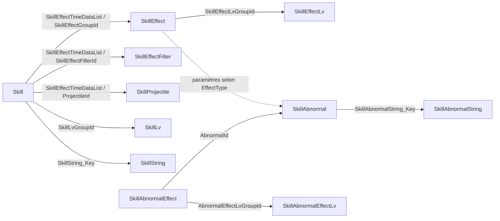

# Compétences : lecture et vérification des relations

Cette étape lit les tables liées aux compétences et produit un diagnostic.
La commande probe-skills ne modifie pas `data.sqlite`, n'active pas de catalogue
et ne résout pas les formules présentes dans les descriptions. La commande
export-catalogue génère ensuite le catalogue commun SQLite.

```sh
cargo run --locked --no-default-features --bin aetheris-game-data -- probe-skills mapping.usmap /client-dechiffre/AION2/Content/Data/Table /travail/skills-probe.json
```

Le dossier de sortie doit exister. Le rapport contient chaque table structurée
avec sa version interne, ses lignes, ses hashes de colonnes et les empreintes
SHA-256 du mapping et du payload, ainsi que les contrôles de relations. Le JSON
renvoyé sur stdout résume les nombres de tables, lignes et références absentes.
Les données du jeu et les rapports réels restent hors de Git.

Le profil explicite de `game_data::skills::TABLES` couvre 41 tables ; toutes
sont requises, même lorsqu'elles sont vides. Les fichiers .bin dont le nom
contient Skill ou Abnormal et qui ne sont pas dans ce profil provoquent un
refus, pour éviter d'omettre silencieusement une nouvelle table. Chaque entrée
est limitée à 64 Mio, l'ensemble des payloads à 128 Mio et le total à un million
de lignes. Les limites du lecteur USMAP et du décodeur strict s'appliquent aussi.

Une lecture interrompue, un fichier manquant ou une erreur de décodage laisse
le rapport précédent intact. La commande vérifie que sa sortie ne remplace ni
le mapping ni un payload d'entrée et publie le résultat atomiquement après
les contrôles. Une référence absente reste un résultat du diagnostic : elle
ne provoque ni suppression de ligne ni remplacement automatique de l'ID.

## Tables couvertes

| Ensemble | Tables |
| --- | --- |
| Définitions et textes | Skill, SkillString, SkillLv |
| Effets directs | SkillEffect, SkillEffectLv, SkillEffectFilter, SkillEffectFilterLocation |
| États appliqués et effets associés | SkillAbnormal, SkillAbnormalEffect, SkillAbnormalEffectLv, SkillAbnormalEffectType, SkillAbnormalOverlapFx, SkillAbnormalProperty, SkillAbnormalString, AbnormalVolume |
| Acquisition, conditions et comportement | SkillAcquireData, SkillAutoUse, SkillChanneling, SkillCharge, SkillCond, SkillCondString, SkillControlSetting, SkillProjectile |
| Variantes et présentation | CCSkillMapping, PCContextSkillSlot, SkillHudActionButton, SkillLink, SkillList, SkillTransform, SpecializedSkill, SpecializedSkillParts, SpecializedSkillSlot |
| Équipements et donjons | ItemEquipSubstatSkill, DungeonAbnormalGroup, DungeonAbnormalGroupSet |
| Récolte et artisanat | GatherSkill, GatherSkillEffect, GatherSkillEffectFx, CraftSkill, CraftSkillEffect, CraftSkillEffectFx |

Les noms de fichiers et ceux des structures USMAP ne sont pas toujours
identiques. Par exemple, SkillAbnormal utilise AbnormalTableItem,
SkillAbnormalEffectLv utilise AbnormalEffectLevelTableItem et CCSkillMapping
utilise ClassChangeSkillMappingTableItem. Le profil conserve ces correspondances.

## Sens et limites des relations

Une compétence possède une liste de références vers des **groupes** d'effets.
SkillEffectGroupId ne pointe pas vers l'identifiant d'une seule ligne :
plusieurs effets peuvent appartenir au même groupe. Les filtres et projectiles
sont référencés séparément dans cette liste. Les groupes de niveaux sont
également distincts des identifiants individuels.



Le rapport effectue 55 contrôles. Chacun indique les champs source/cible,
le nombre d'occurrences non nulles, celles résolues, celles non retrouvées et
jusqu'à 20 exemples avec l'indice de ligne et l'ID source quand il existe.
Les comptes ne sont pas tronqués. Les valeurs 0, chaînes vides, None et membres
d'enum ::None sont considérés comme des absences de référence. Un champ attendu
manquant ou une référence d'un type incorrect fait échouer l'analyse.

Six contrôles de paramètres sont explicitement marqués `inferred_parameter` :

| EffectType | Paramètre, indice à partir de zéro | Cible supposée |
| --- | --- | --- |
| Abnormal, Abnormal_True, Abnormal_Cc | EffectValueList[2] | SkillAbnormal.ID |
| Abnormal_Passive, Toggle | EffectValueList[0] | SkillAbnormal.ID |
| CasterSkill | EffectValueList[0] | Skill.ID |

Ces positions sont vérifiées par recoupement des IDs, mais la réussite du
contrôle ne prouve pas le comportement du client. Les autres paramètres restent
des valeurs source, sans interprétation générale. Les listes gardent leur
ordre, indispensable pour une future lecture des marqueurs se et abe.
Il n'y a aucune déduction de lien à partir des chiffres composant un ID.

Les contrôles vers SkillAbnormalEffectType sont marqués
`target_may_be_partial` : cette table apporte des métadonnées pour certains
types. Un enum sans ligne dédiée ne démontre pas qu'une définition manque.
Ces écarts sont comptés dans `unmatched_type_metadata`, séparément de
`missing_references`.

Les contrôles couvrent les liens explicitement listés dans le lecteur, pas
toutes les interprétations possibles des champs. Les ressources graphiques,
références externes (objets, cartes, créatures), conditions exprimées dans
des paramètres et formules de dégâts/soins restent à examiner. SkillString et
SkillAbnormalString conservent leurs clés ; les textes traduits sont dans les
fichiers L10N. Aucun rattachement automatique aux identifiants observés dans
les événements réseau n'est déclaré par cette analyse.

## Consultation des effets par niveau

La fiche d’un effet sélectionne ses paramètres et son aggro dans la même ligne
de niveau. Une surcharge d’aggro à zéro remplace la valeur de base ; seule une
valeur absente utilise le repli de base. Les valeurs d’aggro restent des valeurs
source, sans calcul d’une menace totale ou d’une contribution par coup.

Les conditions de `SkillEffectConditionList` apparaissent dans une section
distincte de la fiche SE, à tous ses niveaux. Les paramètres et l’expression
booléenne source sont conservés à l’affichage, y compris `false`, sans inventer
le sens de la formule. Une altération ABE portant le même identifiant n’hérite
pas de ces conditions SE.

## Résultats sur la copie du build Steam 26581260

Les PAK sont rattachés à ce build par confirmation de l'opérateur. Le mapping
est le même que pour les items : SHA-256
`019f06284f923aa5f12660c5debbefcb99f3a424a16b4d62b8d2fdfd4997ea44`.
Les 41 tables, de version interne 13, contiennent **202 230 lignes**.

| Table principale | Lignes |
| --- | ---: |
| Skill | 16 283 |
| SkillEffect | 31 631 |
| SkillEffectLv | 78 564 |
| SkillAbnormal | 6 708 |
| SkillAbnormalEffect | 12 804 |
| SkillAbnormalEffectLv | 16 751 |
| Autres tables du profil | 39 489 |

CCSkillMapping, CraftSkill, CraftSkillEffect et SkillChanneling sont présentes
mais vides. Elles ne sont pas interprétées comme des fichiers manquants.

Les 202 230 lignes concordent intégralement avec le lecteur de référence
aion2dat.py (Aion2_Client_Decoding), alimenté par le lecteur USMAP v4 KiskEmu.
Pour comparer les représentations, les maps et sets sont ramenés à leurs
entrées ; aucun élément supprimé n'était présent. Le lecteur Rust garde ces
éléments quand ils existent. Cette comparaison valide la lecture structurelle,
sans déclarer de compatibilité générale version/région.

Les liens principaux sont complets : 25 536 références de groupes d'effets,
25 536 références de filtres et 4 717 références de projectiles dans les
compétences, ainsi que les 12 804 rattachements d'effets aux états appliqués.
Les six hypothèses de paramètres ne présentent aucune référence absente.

Six autres contrôles identifient **375 occurrences non retrouvées** :

| Champ source | Cible examinée | Occurrences non retrouvées |
| --- | --- | ---: |
| Skill.SkillString_Key | SkillString.Name | 29 |
| Skill.CancelExceptionSkillIdList | Skill.ID | 275 |
| Skill.TargetFilterId | SkillEffectFilter.ID | 44 |
| SkillEffect.SkillEffectLvGroupId | SkillEffectLv.SkillEffectLvGroupId | 9 |
| SkillCond.CondAbnormalGroupId | SkillAbnormal.GroupId | 2 |
| SkillHudActionButton.SkillId | Skill.ID | 16 |

Ces écarts doivent être examinés avant d'imposer des clés étrangères strictes.
Ils peuvent correspondre à des définitions inutilisées, à des sentinelles
supplémentaires ou à une interprétation à corriger ; aucune de ces causes
n'est affirmée. Les types absents de SkillAbnormalEffectType représentent
séparément 2 484 occurrences : 58 dans SkillAbnormal et 2 426 dans
SkillAbnormalEffect.

Le rapport global est `target/game-data-validation/skills-probe.json`.
Les lectures par table sont dans `target/game-data-validation/skills/` et
la comparaison de référence dans `skills-reference-validation.json`.
Le diagnostic compact, sans les lignes des tables, est conservé dans
`target/game-data-validation/skills-relations.json`.

```sh
cargo test --locked --no-default-features --test game_data_schema --test game_data_usmap --test game_data_skills
```

## Export relationnel dans data.sqlite

L’[export commun](game-data-export.md) conserve les 16 283 définitions de
compétences du build étudié, y compris Item/System, ainsi que les SE/ABE/SEF
et toutes leurs variantes de niveau. Les effets ne sont plus sélectionnés
uniquement à partir des descriptions ou du stagger. Les classes du catalogue
joueur restent distinctes de la présence d’une définition dans les sources.

`skills` conserve noms, descriptions originales, types, icône,
MP, recharge, portée, niveau maximal et stagger simple. `skill_levels`,
`skill_cast_times`, `skill_weapons`, `skill_specializations` et
`skill_conditions` conservent les informations de progression et d’utilisation.
Les paramètres SE/ABE restent ordonnés dans `skill_effect_values`, avec
aggro, cibles, groupes et liens dans les tables associées.

`skill_abnormals` ajoute les textes, classification, cumul et remplacement des
états ; leurs effets restent distincts des SE directs. Les candidats
`skill_abnormal_links` conservent l’ID, la position du paramètre et sa résolution,
sans présenter le sens de tous les paramètres comme vérifié. Les champs
non interprétés et relations source restent accessibles dans les sources
compressées, avec leur build et leur couverture.

Les référentiels internes utilisent SMALLINT avec CHECK 1–32767. Les IDs du
jeu restent inchangés. Les icônes et libellés EN/localisés sont aussi liés aux
référentiels partagés du catalogue. Les images Unreal restent à décoder ;
un répertoire d’images déjà extraites peut alimenter l’export.

SkillGrade contient Common pour les 16 283 lignes de Skill.bin. Le propriétaire
du projet a corrigé le besoin : les compétences n’ont pas de rareté métier.
Le champ technique reste dans la source complète ; il n’alimente aucune colonne
ni table de rareté et n’apparaît pas comme une rareté dans les fiches.

Keen Strike 4003 partage le texte de 11020000, mais ne figure pas dans le
catalogue joueur ; ses restrictions source sont Greatsword, Sword et Mace.
11020000 est listé Gladiateur et requiert Greatsword. Le statut debug de
4003 n’est pas établi. Les variantes sont conservées avec leurs identifiants.

`skill_descriptions::description(db, skill_id, level, localized)` résout les
sélecteurs directs et paramètres reconnus selon le niveau, sans modifier les
modèles stockés. Les formules client non interprétées restent visibles avec
un diagnostic ; aucune quantité n’est inventée. `level` fournit les coûts et
durées avec leurs remplacements zéro, `stagger` les valeurs par effet et leurs
conditions. Les unités source restent distinctes du formatage de l’interface.

Le suivi des changements entre builds et la publication atomique sont gérés
uniquement par `target_export`, sans migration des anciens schémas ni journal
d’anciens contenus. Voir l’export commun pour la couverture et les limites.
