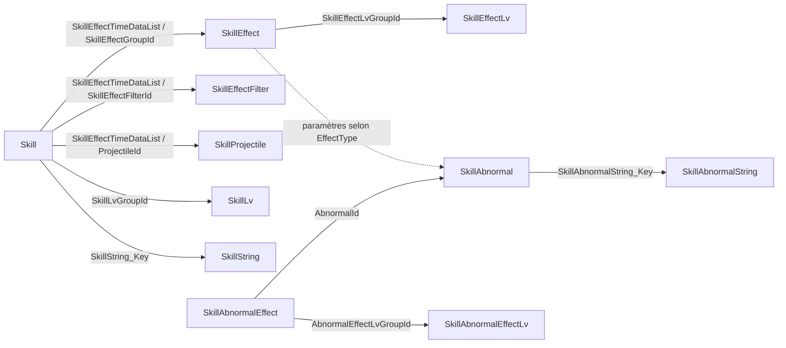

# Compétences : lecture et vérification des relations

Cette étape lit les tables liées aux compétences et produit un diagnostic.
La commande probe-skills ne modifie pas `data.sqlite`, n'active pas de catalogue
et ne résout pas les formules présentes dans les descriptions. La commande
export-skills, décrite plus bas, génère ensuite les tables SQLite.

```sh
cargo run --locked --no-default-features --bin aetheris-game-data -- probe-skills mapping.usmap /client-dechiffre/AION2/Content/Data/Table /travail/skills-probe.json
```

Le dossier de sortie doit exister. Le rapport contient chaque table structurée
avec sa version interne, ses lignes, ses hashes de colonnes et les empreintes
SHA-256 du mapping et du payload, ainsi que les contrôles de relations. Le JSON
renvoyé sur stdout résume les nombres de tables, lignes et références absentes.
Les données du jeu et les rapports réels restent hors de Git.

Le profil explicite de `game_data::skills::TABLES` couvre 41 tables ; toutes
sont requises, même lorsqu'elles sont vides. Les fichiers .bin dont le nom
contient Skill ou Abnormal et qui ne sont pas dans ce profil provoquent un
refus, pour éviter d'omettre silencieusement une nouvelle table. Chaque entrée
est limitée à 64 Mio, l'ensemble des payloads à 128 Mio et le total à un million
de lignes. Les limites du lecteur USMAP et du décodeur strict s'appliquent aussi.

Une lecture interrompue, un fichier manquant ou une erreur de décodage laisse
le rapport précédent intact. La commande vérifie que sa sortie ne remplace ni
le mapping ni un payload d'entrée et publie le résultat atomiquement après
les contrôles. Une référence absente reste un résultat du diagnostic : elle
ne provoque ni suppression de ligne ni remplacement automatique de l'ID.

## Tables couvertes

| Ensemble | Tables |
| --- | --- |
| Définitions et textes | Skill, SkillString, SkillLv |
| Effets directs | SkillEffect, SkillEffectLv, SkillEffectFilter, SkillEffectFilterLocation |
| États appliqués et effets associés | SkillAbnormal, SkillAbnormalEffect, SkillAbnormalEffectLv, SkillAbnormalEffectType, SkillAbnormalOverlapFx, SkillAbnormalProperty, SkillAbnormalString, AbnormalVolume |
| Acquisition, conditions et comportement | SkillAcquireData, SkillAutoUse, SkillChanneling, SkillCharge, SkillCond, SkillCondString, SkillControlSetting, SkillProjectile |
| Variantes et présentation | CCSkillMapping, PCContextSkillSlot, SkillHudActionButton, SkillLink, SkillList, SkillTransform, SpecializedSkill, SpecializedSkillParts, SpecializedSkillSlot |
| Équipements et donjons | ItemEquipSubstatSkill, DungeonAbnormalGroup, DungeonAbnormalGroupSet |
| Récolte et artisanat | GatherSkill, GatherSkillEffect, GatherSkillEffectFx, CraftSkill, CraftSkillEffect, CraftSkillEffectFx |

Les noms de fichiers et ceux des structures USMAP ne sont pas toujours
identiques. Par exemple, SkillAbnormal utilise AbnormalTableItem,
SkillAbnormalEffectLv utilise AbnormalEffectLevelTableItem et CCSkillMapping
utilise ClassChangeSkillMappingTableItem. Le profil conserve ces correspondances.

## Sens et limites des relations

Une compétence possède une liste de références vers des **groupes** d'effets.
SkillEffectGroupId ne pointe pas vers l'identifiant d'une seule ligne :
plusieurs effets peuvent appartenir au même groupe. Les filtres et projectiles
sont référencés séparément dans cette liste. Les groupes de niveaux sont
également distincts des identifiants individuels.



Le rapport effectue 55 contrôles. Chacun indique les champs source/cible,
le nombre d'occurrences non nulles, celles résolues, celles non retrouvées et
jusqu'à 20 exemples avec l'indice de ligne et l'ID source quand il existe.
Les comptes ne sont pas tronqués. Les valeurs 0, chaînes vides, None et membres
d'enum ::None sont considérés comme des absences de référence. Un champ attendu
manquant ou une référence d'un type incorrect fait échouer l'analyse.

Six contrôles de paramètres sont explicitement marqués `inferred_parameter` :

| EffectType | Paramètre, indice à partir de zéro | Cible supposée |
| --- | --- | --- |
| Abnormal, Abnormal_True, Abnormal_Cc | EffectValueList[2] | SkillAbnormal.ID |
| Abnormal_Passive, Toggle | EffectValueList[0] | SkillAbnormal.ID |
| CasterSkill | EffectValueList[0] | Skill.ID |

Ces positions sont vérifiées par recoupement des IDs, mais la réussite du
contrôle ne prouve pas le comportement du client. Les autres paramètres restent
des valeurs source, sans interprétation générale. Les listes gardent leur
ordre, indispensable pour une future lecture des marqueurs se et abe.
Il n'y a aucune déduction de lien à partir des chiffres composant un ID.

Les contrôles vers SkillAbnormalEffectType sont marqués
`target_may_be_partial` : cette table apporte des métadonnées pour certains
types. Un enum sans ligne dédiée ne démontre pas qu'une définition manque.
Ces écarts sont comptés dans `unmatched_type_metadata`, séparément de
`missing_references`.

Les contrôles couvrent les liens explicitement listés dans le lecteur, pas
toutes les interprétations possibles des champs. Les ressources graphiques,
références externes (objets, cartes, créatures), conditions exprimées dans
des paramètres et formules de dégâts/soins restent à examiner. SkillString et
SkillAbnormalString conservent leurs clés ; les textes traduits sont dans les
fichiers L10N. Aucun rattachement automatique aux identifiants observés dans
les événements réseau n'est déclaré par cette analyse.

## Résultats sur la copie du build Steam 26581260

Les PAK sont rattachés à ce build par confirmation de l'opérateur. Le mapping
est le même que pour les items : SHA-256
`019f06284f923aa5f12660c5debbefcb99f3a424a16b4d62b8d2fdfd4997ea44`.
Les 41 tables, de version interne 13, contiennent **202 230 lignes**.

| Table principale | Lignes |
| --- | ---: |
| Skill | 16 283 |
| SkillEffect | 31 631 |
| SkillEffectLv | 78 564 |
| SkillAbnormal | 6 708 |
| SkillAbnormalEffect | 12 804 |
| SkillAbnormalEffectLv | 16 751 |
| Autres tables du profil | 39 489 |

CCSkillMapping, CraftSkill, CraftSkillEffect et SkillChanneling sont présentes
mais vides. Elles ne sont pas interprétées comme des fichiers manquants.

Les 202 230 lignes concordent intégralement avec le lecteur de référence
aion2dat.py (Aion2_Client_Decoding), alimenté par le lecteur USMAP v4 KiskEmu.
Pour comparer les représentations, les maps et sets sont ramenés à leurs
entrées ; aucun élément supprimé n'était présent. Le lecteur Rust garde ces
éléments quand ils existent. Cette comparaison valide la lecture structurelle,
sans déclarer de compatibilité générale version/région.

Les liens principaux sont complets : 25 536 références de groupes d'effets,
25 536 références de filtres et 4 717 références de projectiles dans les
compétences, ainsi que les 12 804 rattachements d'effets aux états appliqués.
Les six hypothèses de paramètres ne présentent aucune référence absente.

Six autres contrôles identifient **375 occurrences non retrouvées** :

| Champ source | Cible examinée | Occurrences non retrouvées |
| --- | --- | ---: |
| Skill.SkillString_Key | SkillString.Name | 29 |
| Skill.CancelExceptionSkillIdList | Skill.ID | 275 |
| Skill.TargetFilterId | SkillEffectFilter.ID | 44 |
| SkillEffect.SkillEffectLvGroupId | SkillEffectLv.SkillEffectLvGroupId | 9 |
| SkillCond.CondAbnormalGroupId | SkillAbnormal.GroupId | 2 |
| SkillHudActionButton.SkillId | Skill.ID | 16 |

Ces écarts doivent être examinés avant d'imposer des clés étrangères strictes.
Ils peuvent correspondre à des définitions inutilisées, à des sentinelles
supplémentaires ou à une interprétation à corriger ; aucune de ces causes
n'est affirmée. Les types absents de SkillAbnormalEffectType représentent
séparément 2 484 occurrences : 58 dans SkillAbnormal et 2 426 dans
SkillAbnormalEffect.

Le rapport global est `target/game-data-validation/skills-probe.json`.
Les lectures par table sont dans `target/game-data-validation/skills/` et
la comparaison de référence dans `skills-reference-validation.json`.
Le diagnostic compact, sans les lignes des tables, est conservé dans
`target/game-data-validation/skills-relations.json`.

```sh
cargo test --locked --no-default-features --test game_data_schema --test game_data_usmap --test game_data_skills
```

## Export relationnel dans data.sqlite

La commande suivante ajoute ou régénère les tables des compétences dans la
base partagée. Sans sortie explicite, elle utilise
`%LOCALAPPDATA%\Aetheris\data.sqlite`, comme l'export des items.

```sh
cargo run --locked --no-default-features --bin aetheris-game-data -- export-skills mapping.usmap /client-dechiffre/AION2/Content/Data/Table en-US.json localized.json appmanifest_3393110.acf [sortie.sqlite [fr-FR]]
```

Les crochets indiquent des arguments facultatifs et ne doivent pas être saisis.
Les 41 sources restent lues et contrôlées hors base. L'export ne reproduit pas
leur découpage : **17 tables pour les skills, aucune vue**. Les tables des items
sont conservées indépendamment.

| Table | Contenu |
| --- | --- |
| skills | ID, dernier build modifiant les données conservées, noms EN/localisés, références vers icône, rareté, type et type de dégâts, descriptions, MP, recharge, portée, portée dépendant de l'arme, niveau maximal et stagger simple. |
| skill_levels | Changements de MP/recharge et coûts en points de compétence, stigma, rattachés directement à la compétence et au niveau. |
| skill_weapons | Armes requises, via weapon_id vers skill_weapon_types ; aucune ligne signifie aucune restriction d'arme. |
| skill_cast_times | Incantation de base, variantes par niveau et étapes de charge avec durée et variante de compétence. Aucun casting_time dans skills ou skill_levels. |
| skill_specializations | Parent, compétence spécialisée, niveau requis et description EN/localisée du changement. Le nom et l'icône viennent de la compétence spécialisée. |
| skill_conditions | Conditions d'activation, d'enchaînement, de cible et conditions des effets. Les paramètres sont nommés et groupés ; expression est un booléen. Les sentinelles None et restrictions de cible inactives ne créent pas de ligne. |
| skill_effect_links | Effets associés à chaque compétence et filtres, avec l'ordre des occurrences pour ne pas confondre plusieurs applications. |
| skill_effects | Données nécessaires aux marqueurs se, abe et sef, avec leurs variantes de niveau partagées. |
| skill_effect_values | Paramètres ordonnés de ces effets et de leurs variantes, sans copie par compétence. |
| skill_rarities, skill_types, skill_damage_types, skill_icons, skill_effect_kinds, skill_weapon_types | Référentiels dédupliqués avec IDs SMALLINT bornés entre 1 et 65 535. |
| skill_classes, skill_class_permissions | Classes du catalogue joueur et liens vers leurs compétences et variantes explicitement reliées. |

Les clés des référentiels sont SMALLINT et contraintes à 1–65 535 ; SQLite
stocke les entiers avec une taille variable, sans réserver systématiquement
deux octets. Les familles se/abe/sef et leurs variantes sont reliées par
kind_id dans skill_effects, skill_effect_values et skill_effect_links.
Les paramètres restent TEXT car leur sens dépend du type d'effet.
Les tables à clés composées utilisent WITHOUT ROWID. Aucune colonne JSON ni
ligne source brute n'est stockée.

La langue est partagée avec les items via localization_language. Un import
qui mélangerait deux langues dans une base déjà remplie est refusé : pour
changer de langue, générer les deux ensembles dans un nouveau fichier avant
remplacement. Il n'y a plus de table skill_localization_language.

Seuls les effets référencés par les compétences, les descriptions (y compris
celles des items déjà dans la base), les spécialisations et les applications
d'états sont retenus, avec les variantes correspondantes. Les animations,
effets visuels, projectiles, sources orphelines et autres champs hors périmètre
restent dans le diagnostic hors SQLite. Les positions des paramètres et les
valeurs zéro/None significatives des formules sont conservées.

L'icône correspond au chemin SkillIcon du client. Les définitions dont le
SkillType source vaut Item ou System sont exclues du catalogue, même si leur
booléen bIsStigmaSkill est vrai. Une exception conserve une définition utilisée
explicitement comme spécialisation ou étape de charge d'une compétence retenue.
Les SE/ABE et leurs niveaux nécessaires aux descriptions des items restent
sélectionnés indépendamment, sans conserver leurs compétences Item/System.
Sur les autres compétences, bIsStigmaSkill est prioritaire pour le type Stigma.

La rareté conserve la valeur source SkillGrade, sans exception manuelle.
Legend reste affiché Unique. Sur ce build, les 16 283 valeurs source sont Common,
ce qui ne correspond pas au Rare observé en jeu pour Condemnation 17350000.
La vérification directe de Skill.bin retrouve 16 283 chaînes EItemGrade::Common
encodées en UTF-16 XOR, aucune EItemGrade::Rare : Common n'est pas une valeur
de remplacement ajoutée par le lecteur. Les 41 tables du profil ne fournissent
pas d'autre champ de rareté identifié pour ces compétences. L'origine de la
rareté affichée en jeu reste à déterminer ; SkillGrade ne doit donc pas être
présenté comme une rareté d'interface validée. Une traduction absente reste NULL.

Les classes proviennent des références explicites de SkillList et des
acquisitions dont bSkillListUI est vrai. Elles sont propagées via les liens
de spécialisation et de charge, sans analyser les chiffres des IDs.
is_listed distingue les entrées explicitement listées des variantes héritant
de leur classe. Une absence de classe signifie non classé dans ce catalogue joueur, pas
automatiquement debug. Les restrictions d'arme restent celles de
NeedMainWeaponTypes : elles ne sont pas inventées à partir de la classe.
Par exemple, Condemnation 17350000 appartient au Cleric et requiert Mace ;
l'homonyme 1503070 possède une animation de PNJ et n'est pas associé à une
classe joueur par les sources examinées.

Keen Strike (Coup acéré) illustre aussi cette distinction : 4003 partage la clé
de texte du skill joueur, mais n'est pas listé dans le catalogue et accepte
Greatsword, Sword et Mace. Son animation est Gladiator_Skill002_BU et son
niveau maximal vaut 1. L'entrée Gladiateur listée est 11020000, avec
Greatsword uniquement, l'animation Gladiator_Skill002 et 40 niveaux. Le statut
debug de 4003 n'est pas établi ; ses restrictions source sont conservées.

### Niveaux et descriptions

Les descriptions stockées conservent leurs modèles `{…}`.
`game_data::skill_descriptions::description(db, skill_id, level, localized)`
rend les sélecteurs directs se/abe et sef:target_count_max avec les paramètres
du niveau demandé, ou la base lorsqu'aucun remplacement explicite n'existe.
Les variantes sont reliées par groupe, sans déduction à partir des chiffres
d'un ID. Les formats none, divide10, divide100, divide1000, divide100abs,
noneabs et les anciens suffixes _100/_1000 sont traités. time est interprété
par division par 1 000, cohérente avec les durées observées ; le formatage exact
de l'interface reste à comparer en jeu.

Les formules de dégâts/soins se_dmg, se_abe_dmg et les applications se_abe dont
le niveau dépend de l'effet parent restent à interpréter. Les marqueurs
inconnus ou les paramètres manquants restent visibles et sont retournés dans
unresolved. Ils ne sont pas remplacés par des dégâts supposés.

`skill_descriptions::level(db, skill_id, level)` fournit les coûts et durées
effectifs, en conservant les remplacements égaux à zéro. Une absence de coût
MP de base est NULL. `skill_descriptions::stagger` fournit les dégâts de stagger
par effet et niveau, avec un indicateur de condition ; aucun total supposant un
nombre de coups n'est calculé. skills.stagger_damage est renseigné lorsqu'un
seul effet de stagger sans condition d'effet permet une lecture directe.
Les durées et portées des tables restent dans les unités source.

### Régénération

Chaque compétence pointe vers le dernier client_version où ses données utiles
ont été observées modifiées. La comparaison inclut ses tables liées, les
paramètres d'effets, leurs niveaux et les effets d'états appliqués. Les hashes
sont calculés pendant l'import, sans les enregistrer ni créer d'historique.
Un changement de langue seule ne marque pas de modification du jeu.
La migration depuis les anciennes tables techniques établit une nouvelle
référence pour ce modèle compact.

Le format partagé est v5. Les imports conservent les tables des items, et
l'import des items conserve les tables et index des compétences. Une copie
cohérente est modifiée dans une base temporaire, contrôlée par integrity_check
et foreign_key_check, compactée, puis publiée atomiquement. Un ancien build
ou une erreur laisse le fichier précédent intact. Les JSON sont limités à
64 Mio et la lecture de la base partagée à 512 Mio.

```sql
SELECT s.id,s.name_en,s.name_localized,i.path AS icon,s.description_localized
FROM skills s LEFT JOIN skill_icons i ON i.id=s.icon_id WHERE s.id=11010000;

SELECT * FROM skill_levels WHERE skill_id=11010000 ORDER BY level;

SELECT specialized.id,specialized.name_localized,p.required_level,p.description_localized
FROM skill_specializations p
JOIN skills specialized ON specialized.id=p.specialization_id
WHERE p.skill_id=11010000;
```

La base réelle est `target/game-data-validation/data.sqlite`, hors de Git.
Elle contient 13 777 compétences après exclusion des 2 506 définitions Item/System,
les 9 452 items conservés, 37 tables au total et aucune vue. Aucun Item/System
n'est requis comme spécialisation ou étape de charge dans ce build. Les
paramètres retenus concordent avec les sources et les dépendances des
descriptions conservées sont vérifiées. Une régénération identique
conserve les versions des compétences. Les résumés d'import et de
validation sont skills-export-summary.json et shared-database-validation.json
dans le même dossier.

```sh
cargo test --locked --no-default-features --lib skill_
cargo test --locked --no-default-features --test game_data_items --test game_data_skills
```
